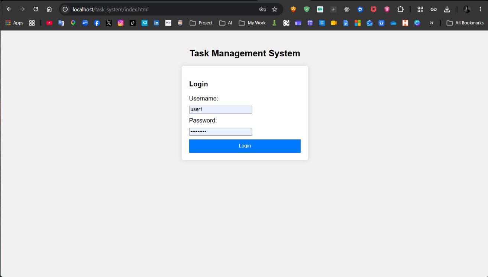
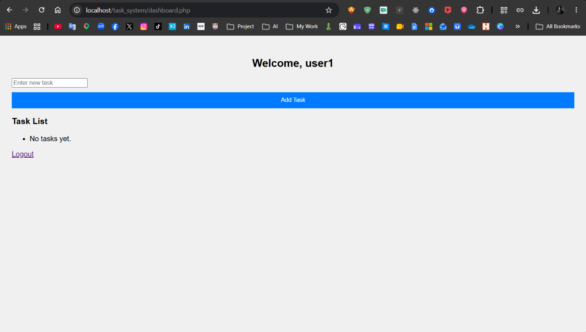
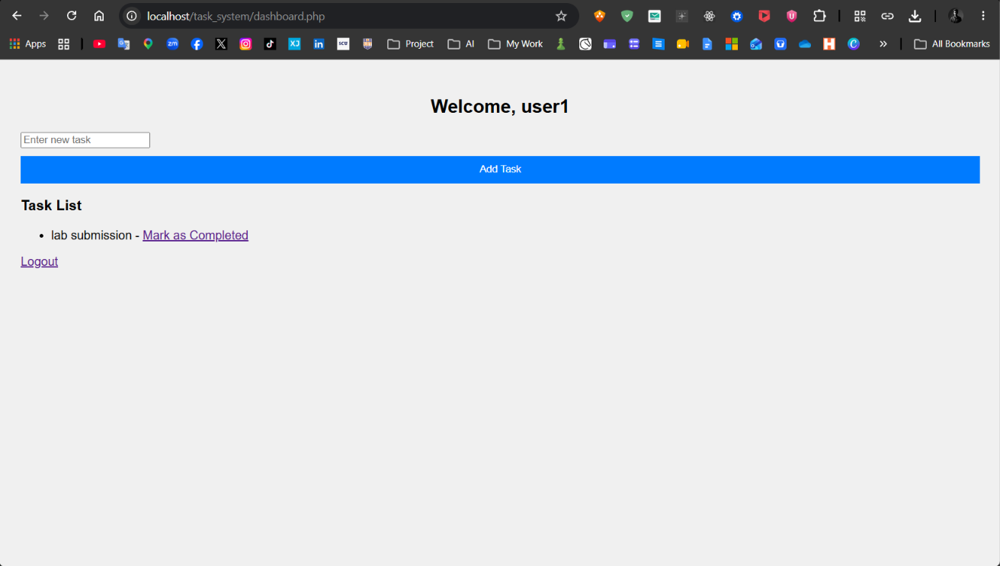
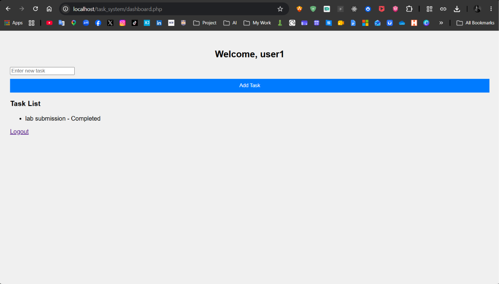

# Task Management System

A simple PHP task management system for demonstrating full-stack web development with HTML, CSS, PHP sessions, and basic authentication.

## Features

- Login with two demo users
- Create and view tasks
- Mark tasks as completed
- Session-based task storage
- Logout and session cleanup

## Technology

- HTML
- CSS
- PHP
- PHP sessions
- Apache (XAMPP)

## Project Structure

```text
task_system/
├── index.html              # Login page
├── login.php               # Authentication
├── dashboard.php           # Add and list tasks
├── complete_task.php       # Mark a task as completed
├── logout.php              # End the session
├── styles.css              # Application styling
├── evidence                # Demonstration screenshots
│   ├── add-task-list.png
│   ├── complete-task-list.png
│   ├── dashboard-page.png
│   └── login-page.png
└── doc                     # Lab documentation
    ├── Practical-Lab6-Task2.pdf
    └── LAB6-TASK2.md
```

## Running the Application

1. Install [XAMPP](https://www.apachefriends.org/).
2. Copy this project into the XAMPP `htdocs` directory.
3. Start **Apache** from the XAMPP Control Panel.
4. Open [http://localhost/task_system/](http://localhost/task_system/) in a browser.

No database is required. Users and tasks are stored in PHP sessions for demonstration purposes.

## Demo Credentials

| Username | Password |
| --- | --- |
| `user1` | `password1` |
| `user2` | `password2` |

## Usage

1. Log in with one of the demo accounts.
2. Enter a task and select **Add Task**.
3. Select **Mark as Completed** beside a task.
4. Select **Logout** to end the session.

Each user has an independent task list because tasks are stored in the user's session.

## Evidence

### Login



### Dashboard



### Adding a Task



### Completing a Task



## Limitations

This is an educational demonstration. Credentials are hardcoded, tasks are not persisted in a database, and the application is not intended for production use.
